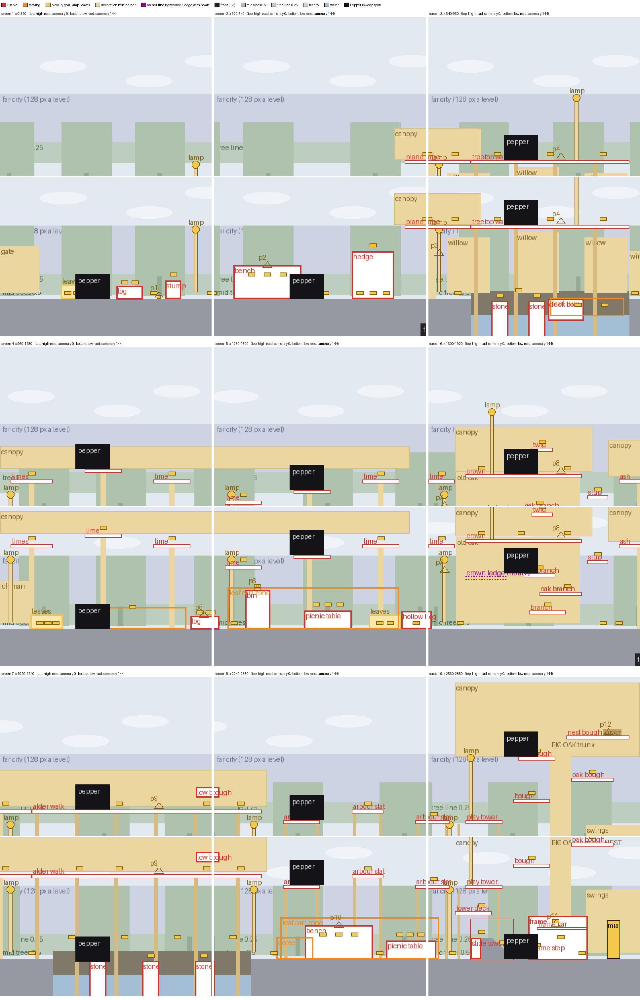
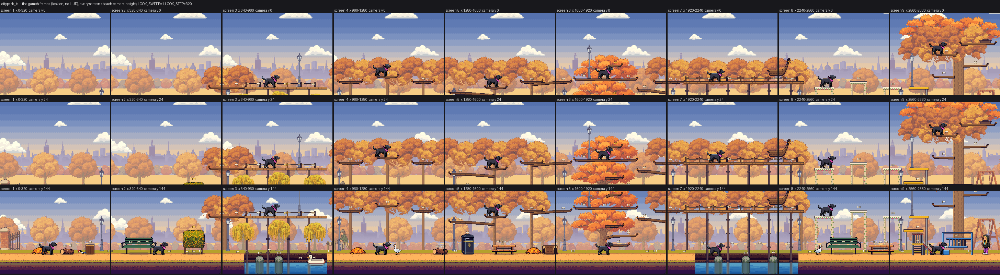
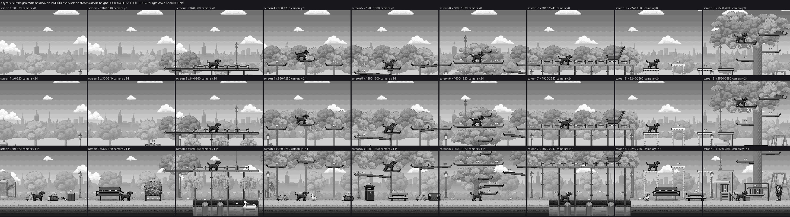

# FETCH! Layer Plans: City Park (tall)

25 to 26 Oct 2026 · prep for Anatoliy Gromov · branch `night/25oct-cp-plan` from prod/integrate c1c37a4

Every screen is specified layer by layer before any art is made: what is far, what is behind Pepper, what she can use, what moves, what is in front. An asset is then made for one slot on one layer, never as "a nice picture of a park".

This tab works City Park through in the form of the River Walk tab. City Park in the approved order is the tall version, `citypark_tall`: 9 screens x 48 rows, 2880 x 384 px, the low road on the path at y 328 and the high road through the treetops at y 88 to 232. It is a Tiled map (maps/citypark_tall.tmx, exported to riverwalk/level/tiled/citypark_tall.lua); its art is placed by scene code (L.art = "park": scene.lua Sc.drawFarArt, Sc.drawTreetops, Sc.drawPropArt).

All numbers come from the engine, the level export and the art files on prod/integrate c1c37a4, 25 Oct, measured with three tools on this branch: `tools/layer_wireframe_tall.py` (the level file, placed as the park art code places it), `tools/layer_frames_tall.py --ids` (the game's own frames, with every pixel tagged by the layer that drew it) and `tools/measure_layers.py`. Nothing in the level, the engine or the art was changed. 0 credits.

## City Park layer stack

City Park has 11 layers, drawn far to near in a fixed order. Three move with Pepper (back, ground, play); everything behind moves slower, the front faster. Two things are new against River Walk. The level is tall, so every layer also has a vertical scroll: on the high road the far layers rise slower than the world. And the treetops are a decoration layer of their own (trunks, canopies, the walks' legs, the arbour's posts), built in code from the level's boxes.

Numbers from scene.lua, look.lua, stage.lua and vcam.lua. The far city moves at most 128 px over the whole level. The tree line moves 0.25, the mid trees 0.5, the front bushes 1.3. Up and down, the sky, clouds, far city and tree line move 0.3 of the camera's rise and the mid trees 0.6 (Vc.parallax). In an art level the sky rises with the far city (0.3), not at the greybox sky's 0.1 that the River Walk tab quotes. The camera rests at y 144 on the path; on the high road it settles with her floor at screen y 168, which is camera y 16 to 64 on most ledges and 0 at the golden twig and in the big oak.

The exact draw order, first (furthest) to last (nearest), as St:draw runs it for City Park. Haze = how far the look pulls each layer towards the level's haze colour: the load-time fade first (look.lua `fade`), then the layer's shader; "none" means drawn as made.

| # | Pass | Scroll x | Scroll y | Haze | City Park contents | Kind |
| --- | --- | --- | --- | --- | --- | --- |
| 0 | Sky | fixed | 0.3 | none | 10 flat colour bands, 5 deeper ones above y 0 for the high road | far |
| 1 | Clouds | 0.05 + drift | 0.3 | 14 % | 8 cloud sprites, high clouds at y -104 to -40 | far |
| 2 | Far city | 128 px over the level | 0.3 | 52 % | River Walk's Stockholm skyline (320 x 77, bottom at y 150) | far |
| 3 | Far tree line | 0.25 | 0.3 | 35 % fade + 30 % | park_treeline (480 x 31, bottom at y 177) | far |
| 4 | Mid trees | 0.5 | 0.6 | 48 % fade + 14 % | park_tree1 and park_tree2 (87 x 107), 100 to 180 px apart, bottom at y 180 | far |
| 5 | Pond and creek | 1.0, rows drift | 1.0 | 6 % | the far bank (lawn and earth), water rows of the river art; the water she falls into | far, hazard |
| 6 | Treetop decoration | 1.0 | 1.0 | 20 % fade + 10 % (walk legs, tower posts: not faded, 10 %) | 8 trunks of 8 to 12 px, the big oak's 32 px trunk, 5 canopies of tree crowns, 18 legs and posts, roses | decoration |
| 6b | Back props | 1.0 | 1.0 | 20 % fade + 10 % (gate 28 %, winch man 35 %; the nest not faded) | gate, 3 willows, old oak, swings, winch man, nest | decoration |
| 7 | Ground | 1.0 | 1.0 | none | path, earth bands, cut banks, the slide | terrain |
| 7b | Lamp posts | 1.0 | 1.0 | back look | 11 checkpoints: 8 on the path, 3 on the high road | signal |
| 7c | Play props | 1.0 | 1.0 | none | log, stump, bench, hedge, stones, bin, picnic tables, oak branches, frame; the high road's 23 ledges | obstacle |
| 7d | Duck boat | 1.0 | 1.0 | none | the duck boat on its rope | obstacle (mover) |
| 7e | Bones, leaf piles | 1.0 | 1.0 | none (leaves: play look) | 97 bones, 3 leaf piles drawn over them | pickup, signal |
| 7f | Hollow log | 1.0 | 1.0 | none | the hollow log | obstacle |
| 7g | Mia, ball, magpie, geese | 1.0 | 1.0 | none | Mia, the ball, the magpie (drawn in code), 2 geese | goal, hazard |
| 7h | Leaf carts | 1.0 + 100 to 105 px/s | 1.0 | none | the keeper pushing his barrow, 2 zones | hazard |
| 7i | Pepper | 1.0 | 1.0 | none | Pepper, dust, the carried ball | player |
| 8 | Front props | 1.3 | 1.0 | 40 % | 2 bushes (park_bush, 75 x 34) | front |
| 9 | Front band | - | - | - | none: look.lua leaves City Park without one, "the earth band is already the dark frame" | front |

Three depth faults found.
- The canopies behind the high road (layer 6, 1.0) are cut from the same art as the mid trees (layer 4, 0.5): the crowns of park_tree1 and park_tree2, 87 px wide in both. Two depths, one size, so the eye reads one row of trees and the high road's ledges float in front of it.
- The high road has nothing in front of it. At camera y 0 and 24 the front layers cover 0 % of the screen; the bottom of the screen is mid trees and canopy (luma 134 to 164), lighter than the ledges she stands on.
- The big oak, the level's landmark, is only in the world (x 2600 to 2880). The beat sheet asks for its silhouette in a far layer from screen 5 on; no far layer has it.

The pond is in the world at 1.0, so the duck boat (1.0) does not slide over its water as River Walk's rowing boats do.

## Interactive vs decoration

A child must tell at a glance what Pepper can use. So every placed thing is one of seven kinds, and each kind has one layer, one base line and one way of being drawn.

| Kind | Layer | Stands at | Drawn | City Park examples |
| --- | --- | --- | --- | --- |
| Obstacle or perch (she stands on it, crawls under it, jumps over it) | Play | The path, y 328 (stones 332, boat deck 346); the high road's ledges, y 88 to 232 | Crisp, mid-tone, unbroken 1 px dark outline, front face and a thin cap, true scale within her 46 px jump | Low: log, stump, bench, hedge, stepping stones, duck boat, bin, picnic tables, hollow log, the old oak's branches, slide tower, play tower deck, climbing frame. High: plane tree, treetop walk, 7 limes, crown, twig, stub, ash, alder walk, low bough, 3 arbour slats, play tower top deck, 4 big oak boughs |
| Hazard (moves, hurts) | Play | Her line | Outlined like an obstacle, plus a tell before it hits | geese (hiss, BARK: SHOO!), the leaf carts (warning sign, CART! GET UP HIGH!), the pond and the creek |
| Pickup or goal | Play | Floating over her line | Small, warm and bright, outlined | 97 bones (5 gold, one of them the golden bone), the ball, Mia, the magpie that carries the ball (12 perches) |
| Signal (decoration that reacts) | Back, or her line by design | Back edge of the path, y 318; on the high road, the ledge | Drawn as decoration until it reacts | 11 lamp posts, 3 leaf piles (they flatten and hide bones; she runs through them) |
| Decoration behind her | Back | y 318, 10 px behind her line | No outline, edges by a darker shade of its own colour, faded to the level's haze; never a box shape at obstacle height | gate, 3 willows, old oak, swings, winch man; the treetop trunks, canopies, walk legs, arbour posts, tower posts; the big oak's trunk and the nest |
| Far scenery | Sky to mid trees | Fixed screen bands that rise 0.3 and 0.6 | Light, low contrast, no outline; nothing she can reach | clouds, far city, far tree line, mid trees, the pond's far bank |
| Front frame | Front | Tops at y 365 (screen y 221 on the low road) | Dark silhouette with a rim light; never covers Pepper | 2 bushes; the earth band under the path. Nothing on the high road |

Four rules follow.
- Decoration never stands on her line. Today none does: the play layer holds no decoration but the 3 leaf piles, which react. They are outlined and on the path like the log beside them, so they read as obstacles she cannot use (decision 9).
- Decoration is never drawn like an obstacle. Today four pieces are. The walk legs are not faded, have a 1 px INK outline and are the darkest decoration in the level (luma 76 on screen; the back layer's darkest 10 % is 76 on screen 7 and 83 on screen 3, 88 to 114 elsewhere). The gate has a dark edge all round (asset_qa decor-ink, 100 %). The nest has an INK outline (it is the goal marker). The play tower's posts are crisp grey, which is right: they belong to the tower.
- A lamp stands on the ground. Three street lamps stand on the high road (x 864 on the treetop walk, 1696 on the crown, 2624 on the tower's top deck): a 4.5 m street lamp in a treetop (bug 14). Lamp 976 stands in front of the winch man.
- Every ledge has art. One has none: 1656 to 1720 at y 248, left of the old oak's trunk. Pepper can stand on it, reached from the oak's branches beside it (y 244, 24 px across; y 272, 48 px across and 24 up). scene.lua gives it to the CROWN prop as its owner, and CROWN draws nothing for it.

And the River Walk rule stands: an obstacle never sits flush against a back piece of the same colour. City Park mostly keeps it (dark bark ledges, play median 91, over canopies at 134 to 138); the arbour slats are the exception (see value, below).

## Scale: everything relative to Pepper

Pepper is the ruler. She is 26 px at the withers (a 0.57 m Labrador), 38 px to the top of her head and 52 px nose to tail, which is 46 px a metre. Every size below is a multiple of her withers height, P = 26 px.

Each layer has one scale. The near layers follow their speed (a layer that moves half as fast is drawn half as big); the far layers keep the scale of their art.

| Layer | Scroll | px per metre | Pepper drawn on it |
| --- | --- | --- | --- |
| Front frame | 1.3 | 60 | 34 px |
| Play, ground, back, treetops | 1.0 | 46 | 26 px: Pepper herself |
| Mid trees | 0.5 | 23 | 13 px |
| Far tree line | 0.25 | about 2 (15 m trees, 31 px) | 1 px |
| Far city | at most 128 px a level | about 0.7 (River Walk's skyline) | - |

The tall level in metres: the world is 384 px, 8.3 m. Above the path there are 328 px, 7.1 m. The high road's ledges are 96 to 144 px over the path (2.1 to 3.1 m), the old oak's crown 3.0 m, its golden twig 3.8 m, the nest bough 5.2 m, the big oak's top 7.0 m. A real park lime branches from about 3 m and stands 15 to 20 m, so the ledges are at true height for a tree's lowest boughs; the trees above them are drawn at a quarter to a fifth of their height.

City Park's pieces and the characters, measured from their files and the level:

| Object | Layer | Real size | Required | Now | Fit |
| --- | --- | --- | --- | --- | --- |
| Pepper | play | 0.57 m at the withers | 1 P, 26 px | 26 (head 38, length 52) | the ruler |
| Mia (7 years) | play | 1.25 m | 2.2 P, 58 px | 59 | fits |
| Magpie | play | 0.45 m long, half of it tail | 21 px long | 24 x 13, drawn in code from a text pattern | size fits; a code-drawn character (owner, 22 Oct: none): make as art |
| Goose | play | 0.75 m standing | 1.3 P, 35 px | 30 | fits (River Walk tab) |
| Park keeper with the leaf cart | play | 1.75 m; barrow 0.65 m tall, 1.4 m long | 3.1 P, 81 px; barrow 30 x 64 | 64 to 65 px frames (bug 8: 61) | too small: reproduce |
| Winch man | back | 1.75 m | 3.1 P, 81 px | 57 to 64 over 8 frames | too small: reproduce |
| Duck boat (pedal boat) | play | 2.6 m long, 1.6 m to the head | 120 x 74 | 54 x 33 (Pepper is 52 long) | too small; the 48 px deck is the mover's box (your call) |
| Log | play | 0.45 m thick | 21 px | 21 | fits |
| Stump | play | 0.6 m | 28 px | 28 (24 wide, drawn in code) | fits |
| Leaf pile | play, signal | 1 m x 0.5 m | 46 x 23 | 49 x 22 | fits |
| Bench (River Walk's) | play | 1.8 m long, seat 0.45 m | 83 long, seat 21 | 103 long, seat 28 | exception: the seat height is the crawl gap |
| Hedge | play | 1.2 to 1.5 m | 55 to 69 px | 72 (1.57 m) on two stems, crawl gap 19 | height fits; redraw to the ground with a leafy gap (board) |
| Stepping stones | play | 0.5 m | 23 px | 24 (art 26) | fit |
| Bin (River Walk's) | play | 1.2 m | 2.1 P, 55 px | 59 | fits |
| Picnic table | play | 0.75 m tall, 1.8 m long | 34 x 83 | 28 x 72 | exception: its top is a perch at bench height (y 300) |
| Hollow log | play | 0.6 m | 28 px | 27 | fits |
| Slide tower | play | platform 1.2 m | 55 px | 32 (top at y 296), art 63 tall | exception: the platform is a running held jump |
| Play tower decks | play | 1.2 m and 2.4 m | 55 and 110 px up | 72 and 112 up | fit |
| Climbing frame | play | 1.8 m | 83 px | 67, top bar 48 up | slightly small; the bars are perches |
| Gate | back | pillars 2.5 m, gate 2 m | pillar 115, gate 92 | 71 tall, 59 wide | too small: redraw (board) |
| Willows | back | 10 m tall, trunk 0.4 m | trunk 18 px, crown cut by the top | whole trees 84 and 92 px, trunks 8 | too small: reproduce |
| Old oak | back, with play branches | 18 m, trunk 1 m | trunk 46 px, crown cut by the top | art 187 x 130 (2.8 m), crown boxes to y 120 (4.5 m), trunk 24 | exception: the branches are the route, 28 px apart; trunk half size |
| Swings | back | frame 2.3 m | 106 px | 96 | fits |
| Lamp post (checkpoint) | back | 4.5 m | 7.9 P, 207 px, cut by the top | 101 | half size: your call (River Walk tab, same art) |
| Treetop trunks (plane, limes, ash, alder) | back | 0.4 to 0.8 m | 18 to 37 px | 8 (plane tree 12, one added trunk 10) | too thin: they read as poles |
| Canopies | back | a lime's crown 8 m across, from 3 m up | wider than the screen, cut by the top | crowns 87 x 78 (park_tree1, 2) and 187 x 76 (park_oak), packed in 5 boxes 34 to 112 px tall | too small: one canopy mass per tree |
| Branch ledges | play | bough 0.2 to 0.3 m | 9 to 14 px | 6, 4 at the tip | thin; the ledge itself fits |
| Treetop walk, alder walk | play | deck 0.15 m, hand rail 1 m | deck 7, rail 46 px | deck 6, rope rail 12 to 15 | rail too low (0.3 m) |
| Walk legs | back | timbers 0.2 m | 9 px | 4 (6 with the outline) | thin, outlined |
| Rose arbour | play slats, back posts | 2.4 m, posts 0.12 m | 110 up, posts 6 | 112 and 128 up, posts 5 | fit |
| Low bough | play | 0.35 m thick | 16 px | 16 | fits; its end curls up into open sky with a leaf clump and reads as a boat's prow |
| Big oak | back trunk, play boughs | 25 m, trunk 1.3 m | trunk 60 px, crown cut by the top | trunk 32 (0.7 m), crown 280 x 112 up to y 8 | trunk half size; exception: the boughs are the route |
| Nest | back | 0.6 m | 28 px | 28 x 10 | fits |
| Lamps on the high road | back | a lantern on a branch, 0.5 m | 23 px | street lamps, 101 | wrong object (bug 14) |
| Bushes | front, 60 px/m | 1.2 x 0.6 m | 72 x 36 | 75 x 34 | fit |
| Mid trees | mid, 23 px/m | 12 m tree, crown 7 m | 276 tall, crown 161 | 107 tall, crown 87 (4.6 m at that scale) | too small, and the same art as the canopies |
| Ball, bones | pickup | 0.07 m ball | 3 px | 6, 11 | exception: pickups at twice true size |
| Clouds, far city, far tree line | far | - | their own scales | - | fit |

Colour and value from the QA tools (`asset_qa.py --all`, 25 Oct; after fades and the look). One City Park fail: park_leaves_flat (8.0 % lone pixels, limit 5; the board's redraw). Warnings: the gate (decoration outlined, 100 % dark edge), the hedge, log and leaves (4.0 to 4.4 % stray), the willows (3.8 to 3.9 % stray, pinholes), the swings (4.2 % stray), the round trees (1.5 % dirt, 4.1 to 4.5 % stray), the oak, tree line, ground, bush and table (noise or blotches), the boat (3.1 % stray), the keeper cart (0.4 % dirt) and the winch man (a colour lost in one frame). Pass: lamp post, bench, bin, slide, hollow log, stones, frame.

Verdict for City Park. Keep as they are: Mia, the goose, log, stump, leaf piles (once redrawn flat), stones, bin, hollow log, play tower, arbour, swings, nest, bushes, far layers. Fix at 0 credits: the walk legs and the gate without an outline, the walk's rail at 1 m, the ledge with no art, lamp 976 off the winch man, the low bough's end. Reproduce: the keeper with the cart and the winch man (adults, 81 px), the gate at true scale, the willows, true-width trunks and one canopy mass per tree, new mid trees. Make as art: the magpie, a treetop lantern. Your call: tree scale, mid trees, the duck boat, the lamp posts.

## City Park screen by screen

City Park is 9 screens of 320 px, each seen from two cameras: the low road (camera y 144, the path at screen y 184, the high road's ledges along the top) and the high road (camera y 0 to 64). The far layers (sky, clouds, far city, tree line, mid trees) are on every screen and are not listed. Screens here are 320 px cuts of the level, so a few pieces fall on other screens than in the beat sheet.

Budget per screen (Playbook): 1 to 2 back landmarks, 4 to 6 play pieces of which at most 3 usable, a front piece every second screen, about 100 px of empty path. On a tall level one more count matters: the low camera shows both roads at once, so a screen with 3 usable pieces on each road shows 6.

| Screen (x) | What she does | Back, behind her | Play: usable (low / high) | Moving, pickups | Front | Change in the redraw |
| --- | --- | --- | --- | --- | --- | --- |
| 1 (0 to 320) | Run, hop the log, meet the magpie (tutorial); no high road | gate | log, stump / none | magpie with the ball (perch 1), leaf pile, lamp 296, 8 bones | - | Gate at true scale (pillars 115 px); the sky over the low road stays open |
| 2 (320 to 640) | Bench, crawl under the hedge; way up 1 (bench seat, hedge top 256, plane tree 216) | none (the plane tree's canopy starts at x 592) | bench, hedge / plane tree from x 608 | perch 2, 8 bones | bush (x 620) | Hedge to the ground with a leafy crawl gap; one back piece allowed |
| 3 (640 to 960) | Stones and the duck boat; high: the plane tree, the treetop walk over the pond | 3 willows, the plane tree's trunk and canopy, 4 walk legs in the pond | 2 stones, duck boat / plane tree, treetop walk | the boat on its rope, perches 3 and 4, lamps 656 and 864 (on the walk), 7 + 6 bones | - | True-width trunks; walk legs without the outline; the walk's lamp becomes a lantern; willows at true scale behind the walk |
| 4 (960 to 1280) | Goose lawn; high: 3 limes | winch man (x 943 to 1011) with lamp 976 in front of him, 3 lime trunks, canopy | log / 3 limes | goose, leaf pile, perch 5, 7 + 3 bones | - | Lamp and winch man apart; winch man at 81 px |
| 5 (1280 to 1600) | Bin (way up 2), picnic table, hollow log, the first cart; high: 3 limes | 2 lime trunks, canopy | bin, picnic table, hollow log / 3 limes | leaf cart zone (1376 to 1560), leaf pile, perch 6, lamp 1306, 8 + 3 bones | - | Keeper at 81 px; 3 usable on each road: nothing added |
| 6 (1600 to 1920) | The old oak's 3 branches (way up 3); high: lime 7, the crown, the golden twig, the stub | old oak, its canopy, a trunk at 1916 | 3 oak branches and 1 ledge with no art / lime, crown, twig, stub | perches 7 and 8, lamps 1624 and 1696 (on the crown), 6 + 6 bones (one the golden bone) | bush (x 1900) | Draw the ledge at y 248 or remove it; the crown's lamp becomes a lantern; high road one over budget (4) |
| 7 (1920 to 2240) | The creek: stop, then hop 3 stones; high: ash, alder walk, the low bough | the ash and alder canopy, 6 walk legs (5 in the creek) | 3 stones / ash, alder walk, low bough | perch 9, lamp 1936, 7 + 4 bones | - | Legs without the outline; the low bough's end goes into leaves, not a prow in the sky |
| 8 (2240 to 2560) | Rose walk: bench, picnic table, the second cart; high: the arbour | arbour posts with roses, a trunk at 2304 added by the code | bench, picnic table / 2 arbour slats | goose (2360), leaf cart zone (2350 to 2576), perch 10, lamp 2300, 9 + 3 bones | - | Keep; give the light slats a value step from the sky |
| 9 (2560 to 2880) | Playground: slide tower, climbing frame, Mia; high: the finale, tower to nest | the big oak's trunk and crown, the nest, swings, tower posts, an arbour post | slide tower, tower deck, climbing frame / slat, top deck, 3 boughs, nest bough | Mia (2840), perches 11 and 12, lamps 2592 and 2624, 8 + 4 bones | - | Busiest screen (3 low, 6 high, 10 in one frame): the finale peak, your call; big oak trunk at true width (60 px); the tower lamp becomes a lantern |

Counts from `tools/layer_wireframe_tall.py --report`: 25 usable boxes on the low road, 23 ledges on the high road (1,896 px of ledge), 97 bones (68 low, 29 high; the beat sheet says 95), 11 lamps, 12 perches, 2 front pieces. Empty path per screen (px of the path at y 328 with nothing on it): 207, 153, 80 (plus 240 px of pond), 239, 116, 315, 80 (plus 240 px of creek), 101, 152.

The wireframe of all 9 screens at both cameras: red boxes are usable, orange moves, yellow is a pickup, a lamp or a leaf pile, beige is decoration behind her, purple is decoration on her line by mistake or a ledge with no art, dark is the front. Pepper stands where the sweep puts her (x = camera + 140, the highest floor).

The game's own frames, every screen at the three camera heights of the sweep (y 0, 24 and 144), in colour and in greyscale (Rec.601 luma, as the look shader):

## What makes it messy today

The clutter comes from layout, scale and value, not only from the art. Measured on the level file and the game's frames:

Both roads in one frame: the low camera shows the high road along its top. On screens 3 to 9 a low-road frame holds 4 to 10 usable pieces (screens 6 and 9: 10; budget: 3) and 10 to 13 bones and pickups.

One tree at two depths: the canopies at 1.0 and the mid trees at 0.5 are the same 87 px crowns. Nothing tells the child which trees she can climb.

Wrong scale behind her: the treetop trunks are 8 px (0.17 m) under crowns 87 px wide, so they read as poles; the willows are 1.8 m saplings; the gate is 1.5 m; the keeper (64 px) and the winch man (57 to 64) stand next to Mia's 59; the duck boat (54 px) is as long as Pepper.

Wrong objects: three street lamps up in the treetops; lamp 976 in front of the winch man; a magpie drawn in code; a ledge at y 248 that nothing draws.

Decoration drawn like obstacles: the walk legs (INK outline, luma 76, the darkest decoration in the level), the gate (dark edge all round), the nest.

Values bunched far back and a dark sky over the high road. Each layer as it shows in the real frames (`layer_frames_tall.py --ids`, median / darkest 10 %, and its share of the screen):

| Layer | High road, camera y 0 | High road, camera y 24 | Low road, camera y 144 |
| --- | --- | --- | --- |
| Sky | 158 / 111, 56 % | 158 / 120, 54 % | 158 / 130, 22 % |
| Clouds | 239 / 201, 5 % | 239 / 201, 4 % | 247 / 201, 2 % |
| Far city | 169 / 157, 5 % | 169 / 157, 5 % | 169 / 157, 6 % |
| Far tree line | 166 / 153, 3 % | 166 / 153, 4 % | 167 / 153, 5 % |
| Mid trees | 164 / 145, 9 % | 164 / 145, 10 % | 164 / 148, 11 % |
| Water | - | - | 104 / 82, 2 % |
| Back (treetops, props) | 138 / 108, 18 % | 136 / 108, 19 % | 134 / 100, 18 % |
| Ground | - | - | 101 / 31, 24 % |
| Play | 91 / 20, 3 % | 91 / 20, 3 % | 87 / 20, 7 % |
| Front | 0 % | 0 % | 23 / 15, under 1 % |

- The far city, the tree line and the mid trees sit within 5 luma of each other (169, 166, 164), where the rule wants one clean step per layer. The cause is in look.lua: the haze colours get lighter as the layers get nearer (city haze luma 171, tree line 177, mid 210), so fading pulls the mid trees towards light and the far city towards mid-tone.
- Over the high road the sky fills 54 to 56 % of the screen at a median of 158, and its top 43 rows are two of the 5 bands added above y 0 (luma 111 and 120): darker than the far city (169) in front of it. The furthest layer is not the lightest there.
- The high road has no front at all: 0 % at camera y 0 and 24. The low road's front is 2 bushes in 9 screens (budget: 4 to 5).
- The arbour slats (cream, luma about 227 before the look) are lighter than the canopy and mid trees behind them: on screen 8 at camera y 0 the play layer's median is 125 against the back's 154. They are outlined, as the ladder asks for a light obstacle, but they read as part of the sky.

The order back to front still holds from the treetops in: back 134 to 138, play 87 to 91, Pepper the darkest shape on every frame.

## How a scene is made from this plan

As in the River Walk tab: this plan approved first, then a greybox frame per screen from the game itself (`tools/layer_frames_tall.py --ids` already gives each layer's area per frame), then art per layer slot, never as a flattened scene, then the screen assembled in the game and checked in colour and greyscale. For a tall level each screen is checked at both cameras. A good sample screen is screen 6 (the old oak): both roads, the crown, the golden bone, a lamp on each road.

Next: the same tab for Downtown (its street and plaza screens, tall). No credits are spent until a level's plan is approved.

## Decisions for you

1. This form for a tall level (a scroll y column, each screen at both cameras, both roads counted in one frame)? Yes, or what to add.
2. Tree scale, the main call. The climbable trees get true-width trunks (lime 23 px, plane 37, big oak 60; today 8, 12 and 32) and one canopy mass each at true scale, its crown running past the top of the world, so the high road sits inside the leaves instead of under an empty sky. The ledges stay where they are: no level change. Yes or no.
3. Mid trees, new art in any case so they are no longer the canopy's crowns: (a) true mid scale, 12 m trees at 276 px, cut by the top, the far city in the gaps; (b) young trees, 6 m at 138 px, the far city over them; (c) keep 107 px. Pick a, b or c.
4. Values: re-order the haze so the furthest layer is the lightest. For example, city haze dccfe0, tree line haze dcc0c4 at 40 %, mid fade 38 %: far city 191, tree line 181, mid trees 154 against back 134 (today 169, 166, 164; computed with measure_layers' maths). Numbers in look.lua only, 0 credits. Yes or no.
5. The sky over the high road: lighten the 5 bands above y 0 (luma 86 to 120 today) so the sky stays lighter than the far city (169), or keep the deeper blue, as Lion King's high skies do? Pick.
6. A front for the high road: dark leaves at the bottom of the screen while the camera is up in the trees (drawn in screen space at 1.4x like River Walk's band, tops at screen y 206 or lower, LOOK_CHECK proving it never covers her). A code change. Yes or no.
7. Signals and characters: treetop lanterns on a branch (0.5 m, 23 px) for the 3 high checkpoints (bug 14); the keeper with the cart and the winch man at 81 px (the board said fix only); the magpie made as art at 24 x 13. Yes, or strike any.
8. Duck boat at 2.6 m (120 px, needs a wider mover and a deck at the same height) or kept at 54 px? Pick.
9. Fixes this plan found, none made: the walk legs and the gate without an outline (a darker shade of their own colour); the walk's rail at 1 m; the ledge at y 248 drawn as a branch or removed; lamp 976 and the winch man apart; the low bough's end; the big oak's silhouette on the tree line from screen 5 on (the beat sheet's ask); the leaf piles drawn without an outline. Yes, or strike any.
10. Screen 9 (3 usable low, 6 high, 10 in one frame, two lamps 32 px apart at 2592 and 2624): keep it as the finale peak, or thin it by moving the path lamp back along the path, away from the tower's lamp? Pick.
