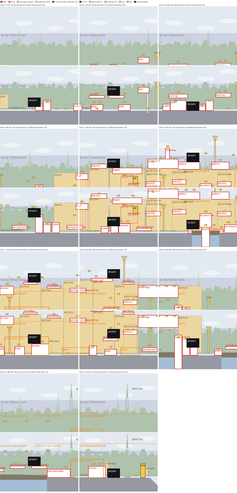
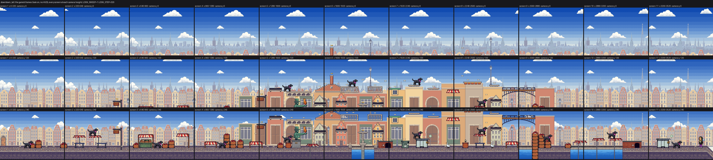
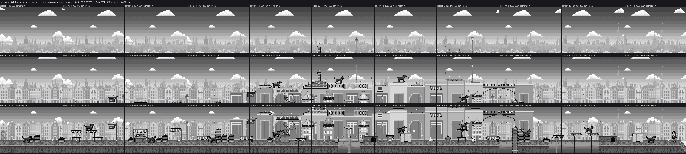

# FETCH! Layer Plans: Downtown (tall)

25 to 26 Oct 2026 · prep for Anatoliy Gromov · branch `night/25oct-dt-plan`, stacked on the City Park plan

Every screen is specified layer by layer before any art is made. This tab works Downtown through in the form of the River Walk and City Park tabs. Downtown in the approved order is `downtown_tall`: 11 screens, 3520 x 480 px, the street at y 424 and a high road over it at y 200 to 280, a Tiled map whose art is placed by scene code (L.art = "town").

Every number is measured from the level export, the art files and the game's own frames, with the City Park tools extended for the town art (`tools/layer_wireframe_tall.py`, `tools/layer_frames_tall.py --ids`, `tools/measure_layers.py`). Nothing in the game was changed. 0 credits.

## Decisions for you

Ordered by how much they change. "Code" means the game's code, no art; new art comes back as its own spend line. None moves anything Pepper stands on.

1. **The high road: first floor or roofs?** Its ledges are 3.1 to 4.2 m above the street, a real first floor; old town eaves are 13 to 16 m up. Today the houses behind stop 2.7 to 4.0 m above the street with roof pieces on top: a row of one-storey shops. (a) First floor: the houses run on past the top of the screen; the stepped gable, chimney (the golden bone), dormer and flower roof become a portal top, a bay window's roof, a window hood and a flower balcony; loggia, galleries and footbridge stay, with railings 1 m high (46 px; 12 to 18 today). (b) Roofs: the houses under them at a quarter of true size, the compressed rule you replaced on 23 Oct. New art either way. Pick.
2. **One scale for the street's houses.** Door heights today: 93 px on the tall fronts (2.0 m as drawn), 25 px on the four small plaza houses in front (0.55 m), 58 px at the start (1.26 m). (a) The plaza houses become true-scale shop fronts, their balconies (1.7 to 2.1 m above the street) drawn as shop canopies; (b) the start door 2.1 m tall (97 px); (c) the old town row behind, at half speed, at its layer's true scale (storeys 74 px; 16 today). The board already asked to redraw (b), (c) and one plaza house. New art. Yes, or strike any letter.
3. **Light to dark.** The far layers run the wrong way: far city 163, far roofs 171, old town row 180, the furthest darkest. New haze colours (the colour each far layer fades towards), measured in the game's frames in a copy: 187, 176, 169, the houses behind her unchanged at 154. Code only, 0 credits. The sky (135, darker than all of them) follows your answer to City Park's decision 4. Yes or no.
4. **The cargo bike's hiding places**, your "super small": the shelter is 1.04 m tall as drawn (a real one is 2.5 m, 115 px), the courtyard gates 0.78 m (a real gateway is 3 m tall, 138 px), yet the bike's 77 px rider rides into one. Their tops are her perches (48 and 36 px up). (a) Shelter and gateways at true scale behind her, the same perches drawn as stacks of the baker's bread crates; (b) keep today's size. New art for (a). Pick.
5. **Art, not code** (no code-drawn characters, owner 22 Oct): the cargo bike and rider at today's size; the vintage tram and driver at true size (156 px tall and 460 long; 130 and 300 today); the tram stop signs 2.5 m tall (115 px; 57 today); wall lanterns (0.5 m tall, 23 px) for the two street lamps on the high road; the cat at true size (15 px sitting; 30 today). New art. Yes, or strike any.
6. **Small fixes** (0 credits, none made): (a) Riddarholmen's spire, the landmark, on screen from screen 1 (today screens 10 and 11 only); (b) balcony railings 1 m high (46 px; 9 today, drawn in code); (c) four more dark front pieces along the street in the map, one every second screen (2 today); (d) the loggia and galleries, by hand, a stone darker than the houses behind them (147 against 128 to 154). Yes, or strike any letter.

Decision 3's haze colours: far city e4eaf0, far roofs bcc8da, old town row b2c3d9 (today a7bad6, b2c3d9, d6dee8).

## Downtown layer stack

10 layers, far to near. Back, ground and play move with Pepper; behind moves slower, the front faster. Up and down, the far layers rise 0.3 of the camera's rise, the old town row 0.6. The camera rests at y 240 on the street and y 64 to 112 on the high road (32 on the chimney); the wireframe uses 120 and 240, as the sweep.

| # | Pass | Scroll x | Scroll y | Haze | Contents | Kind |
| --- | --- | --- | --- | --- | --- | --- |
| 0 | Sky | fixed | 0.3 | none | 10 bands, darker above y 0 | far |
| 1 | Clouds | 0.05 + drift | 0.3 | 4 % | 8 clouds | far |
| 2 | Far city | 128 px a level | 0.3 | 50 % | River Walk's skyline | far |
| 3 | Far roofs | 0.25 | 0.3 | 70 % fade + 34 % | town_roofs; Riddarholmen's spire (36 x 260) | far |
| 4 | Old town row | 0.5 | 0.6 | 25 % fade + 18 % | town_facades (225 x 114) | far |
| 5 | Water | 1.0 | 1.0 | 5 % | fountain basin, canal, flooded square | hazard |
| 6 | Back | 1.0 | 1.0 | 28 % fade + 8 % | 12 tall fronts, the vintage tram (40 %), 2 tram stop signs, start door, 4 plaza houses, river sign | decoration |
| 7 | Ground | 1.0 | 1.0 | none | pavement, quay wall, river stairs | terrain |
| 7b | Lamps | 1.0 | 1.0 | back look | 6 street, 2 high | signal |
| 7c | Cargo bikes | 1.0 + 110 to 130 px/s | 1.0 | none | 2 zones, behind the obstacles | hazard |
| 7d | Play props | 1.0 | 1.0 | none | 50 boxes on the street, 13 high | obstacle |
| 7e | Bones, characters, Pepper | 1.0 | 1.0 | none | 102 bones, Mia, ball, cat, 2 geese, Pepper | pickup, goal, hazard, player |
| 8 | Front props | 1.3 | 1.0 | 40 % | 2 bollards | front |
| 9 | Front band | - | - | - | none: "the quay wall is already the dark frame" | front |

Depth faults:
- Two house scales on one plane: the small plaza houses stand at 1.0 in front of true-scale ground floors at 1.0, so they cannot read as further away.
- The vintage tram (2.8 m tall as drawn) drives in front of the tall fronts but behind the plaza houses, which are shorter than it.
- The spire is on screen only from camera x 2727; the beat sheet wants it from screen 1.

The water is at 1.0: nothing slides over it. The sweep sends no trams or bikes; they show in the wireframe only.

## Interactive vs decoration

| Kind | Layer | Stands at | Drawn | Downtown examples |
| --- | --- | --- | --- | --- |
| Obstacle or perch | Play | street y 424; middle tier y 304 to 352; high road y 200 to 280 | crisp, 1 px dark outline, true scale in her jump | crates, cafe tables, parasols, signs, stall, awnings, tubs, statue, fountain, kiosk, shelters, gates, balconies; high: loggia, guild roof, chimney, galleries, dormer, ledges, window awning, flower roof, footbridge |
| Hazard | Play | her line | outlined, with a tell | 2 cargo bikes (bell, sign), 2 geese, water |
| Pickup or goal | Play | over her line | small, warm, outlined | 102 bones, ball, Mia, the cat on the ball |
| Signal | Back | y 414, or the ledge | decoration until lit | 8 lamp posts |
| Decoration behind her | Back | y 414 | no outline, faded | fronts, plaza houses, start door, signs, the tram |
| Far scenery | Sky to old town row | screen bands | light, no outline | far city, far roofs, spire, old town row |
| Front frame | Front | tops at y 461 | dark, never over her | 2 bollards; nothing high |

- Decoration on her line by mistake: none. The statue is decoration by type, but its arm and hat are ledges and it is drawn as an obstacle: right.
- Decoration drawn like obstacles: the plaza houses (asset QA: 100 %, 42 % and 100 % of their edge dark).
- Lamps belong on the ground: two street lamps (2.2 m tall as drawn; a real one is 4.5 m) stand on the high road (x 1830, 2420).
- Drawn in code: the bike's rider, the tram's driver, the tram stop signs, the balconies.

## Scale: everything relative to Pepper

Pepper is the ruler: 26 px at the withers, 38 to her head, 52 long, 46 px a metre. The front is drawn at 60 px a metre, play and back at 46, the old town row at 23; far layers keep their art's scale. The world is 10.4 m tall: the high road 3.1 to 4.2 m above the street (144 to 192 px), the chimney top 4.9 m, the middle tier (balconies, statue, signs) 1.7 to 2.6 m. True-height roofs would need a world twice as tall: not offered.

"Now" is the size as drawn, and what that measures in metres.

| Object | Layer | Real | Required px | Now | Fit |
| --- | --- | --- | --- | --- | --- |
| Pepper | play | 0.57 m at the withers | 26 | 26 | the ruler |
| Mia; goose | play | 1.25 m tall; 0.75 m standing | 58; 35 | 59; 30 | fit |
| Cat, sitting | play | 0.32 m tall | 15 | 30 (0.65 m) | twice too big |
| Cargo bike rider; bike | play | 1.75 m tall; 2.4 m long | 81; 110 | 77 (1.67 m); 92 (2.0 m), in code | fits |
| Vintage tram | back | 3.4 m tall, 10 m long | 156 x 460 | 130 x 300 (2.8 x 6.5 m), in code | two thirds |
| Tram stop sign | back | 2.5 m tall | 115 | 57 (1.24 m), in code | half |
| Crates; tub; fountain rim | play | 0.3, 0.6 and 0.4 m tall | 14; 28; 18 | 16 a step; 28; 16 | fit |
| Tables, parasols, signs, stall, awnings | play | 0.75 to 3 m high | 35 to 138 | 26 to 120 up (0.57 to 2.6 m) | exception: perches in her jump |
| Statue figure | play | life size, 1.8 m tall | 83 | 68 (1.48 m) | exception: its ledges are 36 and 32 px apart; open on the board |
| Kiosk | play | a cabinet, 1.0 to 1.2 m tall | 46 to 55 | 36 (0.78 m) | slightly small |
| Shelter; gates | play | 2.5 m; 3 m tall | 115; 138 | 48 (1.04 m); 36 (0.78 m) | too small (4) |
| High road pieces | play | dormer 1.5 m, stepped gable 4 to 6 m, railings 1 m, all tall | 69; 184 to 276; 46 | 36 (0.78 m); 40 (0.87 m); 9 to 18 (0.2 to 0.39 m) | a fifth to a third (1, 6); chimney fits |
| Tall fronts | back | door 2.1 m, house 14 m, both tall | 97, past the top | door 93 (2.0 m), house cut 2.7 to 4.0 m up | door fits; house too short (1) |
| Plaza houses; start door | back | door 2.1 m tall | 97 | 25 (0.55 m); 58 (1.26 m) | a quarter; too small (2) |
| Old town row | mid | storey 3.2 m, door 2.2 m tall | 74; 51 | 16; 17 | a quarter (2) |
| Lamp posts | back | 4.5 m tall | 207 | 101 (2.2 m) | your call in the River Walk tab |
| Bollards | front | 0.9 m tall | 54 | 40 (0.67 m) | slightly small |
| Ball, bones | pickup | 0.07 m ball | 3 | 6, 11 | exception: twice true size |

Asset QA (each file as the game draws it): one fail, the bollard (median luma 41, the front allows 40). Warnings: plaza houses outlined, the old town row's contrast (92, allowed 85), lone pixels in the sign, statue, stall and kiosk (3.4 to 4.6 %), blotches in the far roofs, ground and gates. The fronts and high road pieces are not on its list.

Verdict. Keep at today's size and layer (the board's redraws and fixes keep these sizes): Mia, the goose, crates, tables, parasols, signs, stall, street awnings, tubs, fountain, kiosk. Fix at 0 credits: decision 6, and the lone pixels by hand. New art if you say yes: decisions 1, 2, 4, 5. Open: the statue.

## Downtown screen by screen

Each screen at the street camera (y 240) and the high road camera (y 120). Budget per screen (Playbook): 1 to 2 back landmarks, at most 3 usable pieces, a front piece every second screen, about 100 px of empty pavement. A piece is what a child sees as one thing (a crate stack, the statue, the fountain); a box is what the level file holds.

| Screen (x) | What she does | Behind her | Usable pieces (street / high) | Moving, pickups | Change |
| --- | --- | --- | --- | --- | --- |
| 1 (0-320) | Crate steps | start door | crate steps, crates / - | 6 bones | door (2b) |
| 2 (320-640) | Cafe: crawl under, climb the parasols to the sign | - | 2 tables, 2 parasols, sign / - | lamp, 8 bones; bollard | keep |
| 3 (640-960) | Market | - | stall, 2 awnings, crates, crate steps / - | 7 bones | keep |
| 4 (960-1280) | Springy awnings to the bakery sign | bakery | 2 springy awnings, crate wall / - | lamp, 6 bones | value step off the bakery |
| 5 (1280-1600) | The plaza: the cat on the statue; way up A | 2 fronts, bakery, guild house, plaza house | springy parasol, sign, tub, crates, statue, balcony / balcony, loggia | cat, 10 + 4 bones | the circled screen (1, 2) |
| 6 (1600-1920) | Fountain; high: guild roof, chimney, galleries | guild house, a front, 2 plaza houses | 2 balconies, fountain, gate / guild roof, chimney, 2 galleries | 2 lamps, 10 + 8 bones; bollard | portal, bay window (1); lantern (5) |
| 7 (1920-2240) | Cargo bike street; high: dormer, ledges, window awning | 4 fronts, tram stop | kiosk, shelter / dormer, 2 ledges, window awning | bike, tram, goose, lamp, 5 + 7 bones | shelter (4); bike, tram (5) |
| 8 (2240-2560) | Flower market, geese; high: flower roof | 3 fronts, plaza house | tub, table, springy parasol, balcony, springy awning / flower roof, ledge | goose, 2 lamps, 7 + 5 bones | lantern (5) |
| 9 (2560-2880) | Over the canal; high: footbridge | a front | crate tower, crate, springy parasol / footbridge | lamp, 7 + 3 bones | rail (1) |
| 10 (2880-3200) | Flooded square | spire | 2 springy parasols, gate / - | 6 bones | gateway (4) |
| 11 (3200-3520) | Fast bike, Mia | river sign, tram stop, spire | shelter / - | bike, tram, Mia, 3 bones | shelter (4) |

Counts (`layer_wireframe_tall.py --report`): 40 usable pieces on the street (50 boxes), 13 high (13 boxes, 1,000 px of ledge); 102 bones (75 street, 27 high), 8 lamps, 2 front pieces. Usable boxes in one street frame: 3, 6, 6, 6, 12, 12, 7, 8, 6, 3, 1. Empty pavement in px: 236, 208, 159, 224, 208, 122, 188, 238, 68, 32, 216 (plus water on 6, 9, 10).

The wireframe: red usable, orange moving (dashed: the tram's lane), yellow pickup, lamp, cat or Mia, beige decoration behind her, purple decoration on her line by mistake (none), dark front; Pepper where the sweep puts her.

The game's own frames at camera y 0, 120 and 240, in colour and greyscale:

## What makes it messy today

Three house scales on one street: doors of 93 px on the fronts, 25 px on the plaza houses in front of them, 58 px at the start, 17 px in the row behind.

One-storey shops: the high road walks on the cut tops of true-scale ground floors. 11 of the 12 fronts show their top from the street, all 12 from the high road, against the 25 Oct rule.

One plane on the plaza, the screen you circled (screen 5, each piece's median luma in the street frame): the statue 93, its arm 124 and pedestal 135 stand on a cream front of 128; the crates (107) and springy awning (103) on the bakery's 128. Steps of 4 to 35 between what she uses and what is behind it (City Park's: 43 to 47); the pedestal is lighter than its wall.

Over budget: screens 5 and 6 show 12 usable boxes and 16 to 17 bones in one street frame. No level change is proposed: they are the level's peak; scale and value make them clutter.

Each layer in the real frames (median / darkest 10 %, share of the screen):

| Layer | Camera y 0 | y 120 (high road) | y 240 (street) |
| --- | --- | --- | --- |
| Sky | 120 / 69, 69 % | 135 / 95, 53 % | 135 / 108, 23 % |
| Clouds | 236 / 195, 6 % | 236 / 195, 4 % | 246 / 195, 1 % |
| Far city | 173 / 155, 3 % | 169 / 155, 2 % | 163 / 155, under 1 % |
| Far roofs, spire | 177 / 161, 15 % | 177 / 167, 2 % | 171 / 167, under 1 % |
| Old town row | 180 / 156, 6 % | 180 / 141, 22 % | 180 / 141, 19 % |
| Back | under 1 % | 154 / 125, 13 % | 154 / 125, 20 % |
| Ground | - | under 1 % | 89 / 53, 24 % |
| Play | under 1 % | 105 / 15, 3 % | 98 / 2, 10 % |
| Pepper, Mia, bones, cat, geese | under 1 % | 58 / 1, 1 % | 58 / 1, 2 % |
| Front | 0 % | 0 % | 0 % |

- The far layers are inverted because their haze colours get lighter nearer in (luma 184, 192, 221). The ladder doc calls Downtown light to dark because its tool still has the old 10 % fade for the old town row; the game uses 25 %.
- The sky is darker than every far layer.
- On the high road the loggia (147) is lighter than the front under it (128) and the galleries (147) only 7 darker than theirs (154); the other ledges stand 17 to 78 off their fronts.
- No front in any of the 33 frames: the 2 bollards fall between the sweep's spots; the high road has none.

From the back in, the order holds: back 154, play 98 to 105, Pepper 58. Only the cafe tables (40) and the footbridge's iron (15) are darker than her.

## How a scene is made from this plan

As in the River Walk tab: plan, a greybox frame per screen from the game, art per layer slot, then the screen assembled and checked in colour and greyscale at both cameras. The sample screen is screen 5, the plaza you circled: both roads, the statue, the cat, way up A.

Next: with the three plans approved, the art backlog's Downtown families take their sizes from these tables. No credits are spent until a level's plan is approved.
